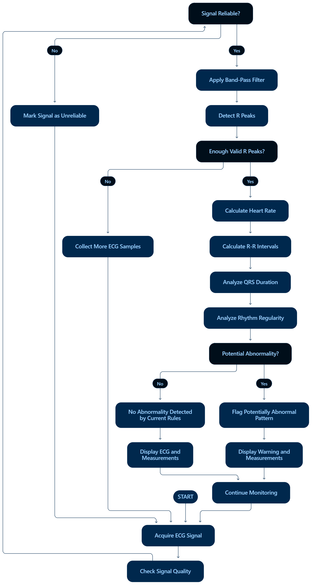

# Pulse-Care: Real-Time IoT & AI Health Monitoring System



**Pulse-Care** is an end-to-end, multi-sensor tele-health and edge-monitoring platform. It captures high-frequency physiological vitals (Electrocardiogram, Blood Oxygen, Optical Pulse) and biomechanical posture/motion data from an ESP32 microcontroller, publishes telemetry across a low-latency MQTT message broker, visualizes real-time analytics on a responsive web dashboard, and feeds processed cardiac data into an AI-driven 1D Convolutional Neural Network (CNN) for automated cardiac arrhythmia detection.

---

## 📑 Table of Contents
1. [System Architecture](#-system-architecture)
2. [Project & Repository Structure](#-project--repository-structure)
3. [Hardware & Pinout Configuration](#-hardware--pinout-configuration)
4. [Communication & MQTT Schema](#-communication--mqtt-schema)
5. [Signal Processing & Deep Learning Pipeline](#-signal-processing--deep-learning-pipeline)
6. [Web Dashboard & Visualization](#-web-dashboard--visualization)
7. [Installation & Getting Started](#-installation--getting-started)
8. [Current Status & Roadmap](#-current-status--roadmap)

---

## 🏛 System Architecture

The system operates across four primary operational tiers:

```
[ AD8232 ECG Sensor ]  ──(Analog ADC1)──┐
[ MAX30102 Oximeter ]  ──(I2C Bus)──────┼─▶ [ ESP32 DevKit V1 Edge Engine ]
[ MPU6050 6-Axis IMU]  ──(I2C Bus)──────┘         │
                                                  ├─▶ [ Local Alarm: Piezo Buzzer ]
                                                  │    (Threshold / Flatline Detection)
                                                  │
                                            (WiFi / MQTT)
                                                  │
                                                  ▼
                                      [ Mosquitto MQTT Broker ]
                                     (Port 1883 TCP / 9001 WS)
                                                  │
                         ┌────────────────────────┴────────────────────────┐
                         ▼                                                 ▼
             [ Web Dashboard Client ]                         [ Python AI / DSP Engine ]
             • React 18 + Vite + Tailwind                     • Butterworth 0.5-40Hz Bandpass
             • 250 Hz Continuous ECG Strip                    • Pan-Tompkins R-Peak Snapping
             • Real-time SpO2 & Heart Rate                    • 187-sample Beat Segmentation
             • 3D Motion & Posture Indicator                  • 1D CNN Arrhythmia Classifier
```

1. **Edge Sensing Layer**: ESP32 reads analog cardiac potentials (AD8232), optical plethysmography (MAX30102), and inertial acceleration/gyroscopic tilt (MPU6050).
2. **Edge Safety Guard**: Firmware-level timeout and flatline monitor triggering a physical hardware alarm (active piezo buzzer) during severe tachycardia, bradycardia, or disconnected leads without requiring network connectivity.
3. **Telemetry & Communication Layer**: Wi-Fi enabled JSON streaming through an Eclipse Mosquitto MQTT message broker supporting dual TCP (1883) and WebSocket (9001) listeners.
4. **Presentation Layer**: React single-page application consuming raw sensor streams directly via WebSocket MQTT at throttled rendering intervals (10 Hz state flushes for 60 FPS UI stability).
5. **AI / Signal Analytics Layer**: Python digital signal processing (DSP) suite executing bandpass filtering, Pan-Tompkins R-peak alignment, and inferring against a trained Keras 1D CNN (`pulsecare_cnn.h5`).

---

## 📁 Project & Repository Structure

```
Pulse Care/
├── mermaid-diagram.png                                    # High-resolution system architecture flowchart
├── mosquitto.conf                                         # MQTT broker config (ports 1883 & 9001)
├── Screenshot 2026-10-24 184844.png                       # System UI / hardware snapshot
│
├── ARDUINO CODES/                                         # Embedded C++ Firmware for ESP32
│   └── sketch_oct20a_copy_20261022154401/
│       ├── PulseCare_ESP32_Edge/
│       │   └── PulseCare_ESP32_Edge.ino                   # Offline emergency alarm logic (Buzzer & Flatline)
│       ├── sample1                                        # Prototype: MPU6050 + AD8232 + MAX30102
│       ├── sample2                                        # Serial plotter debug mode sketch
│       ├── sample3                                        # Production: Multi-sensor integrated MQTT telemetry
│       └── sketch_oct20a_copy_20261022154401.ino          # Initial MPU6050 base implementation
│
├── mpu6050-dashboard/                                     # Real-Time Web Telemetry Dashboard
│   ├── package.json                                       # Root workspace script runner (concurrently)
│   ├── client/                                            # Frontend React 18 application (Vite)
│   │   ├── index.html                                     # Single-page shell
│   │   ├── vite.config.js                                 # Dev server configuration
│   │   ├── tailwind.config.js                             # Dark medical telemetry UI styles
│   │   └── src/
│   │       ├── App.jsx                                    # Main dashboard layout
│   │       ├── components/
│   │       │   ├── ECGChart.jsx                           # High-performance 250 Hz rolling ECG waveform
│   │       │   ├── SpO2Card.jsx                           # MAX30102 Blood Oxygen & optical HR display
│   │       │   ├── LiveChart.jsx                          # Recharts graphs for Accel, Gyro, and Temp
│   │       │   ├── TiltIndicator.jsx                      # CSS 3D simulated orientation box
│   │       │   ├── StatCards.jsx                          # Numerical readouts for IMU telemetry
│   │       │   ├── StatusBar.jsx                          # Broker health, latency & sampling rate meter
│   │       │   └── Controls.jsx                           # Pause, reset, window size & CSV download
│   │       └── hooks/
│   │           └── useSensorSocket.js                     # Unified MQTT WebSocket subscriber & buffer manager
│   └── server/                                            # Node.js Express backend (offline/serial fallback)
│       ├── index.js                                       # Socket.IO & REST endpoints
│       ├── serialReader.js                                # USB Serial port fallback parser
│       └── mockData.js                                    # Synthetic telemetry stream generator
│
├── signal processing/                                     # DSP Algorithms & Deep Learning Pipeline
│   ├── venv/                                              # Dedicated Python 3.11 virtual environment
│   ├── ecg_filter.py                                      # Zero-phase Butterworth bandpass filter (0.5–40 Hz)
│   ├── rpeak_detector.py                                  # Pan-Tompkins R-peak detector with peak snapping
│   ├── heartbeat_segmenter.py                             # 187-sample MIT-BIH aligned beat extractor
│   ├── train_cnn.py                                       # 1D CNN training pipeline with class weighting
│   ├── pulsecare_cnn.h5                                   # Saved Keras model weights (Arrhythmia detection)
│   ├── evaluate_model.py                                  # Accuracy, F1-score & confusion matrix evaluator
│   ├── mock_serial_ecg.py                                 # Real-time multi-panel simulation & inference test
│   ├── test_adaptive_filter.py                            # LMS adaptive noise cancellation simulation
│   └── mitbih_train.csv / mitbih_test.csv                 # MIT-BIH benchmark ECG datasets
│
└── Pulse-Care/                                            # Git tracking repository (GitHub clone)
    └── .git/                                              # Remote: https://github.com/yuneth-hansira/Pulse-Care.git
```

---

## ⚡ Hardware & Pinout Configuration

### ESP32 DevKit V1 Pin Assignments

| Subsystem / Sensor | Pin Label | ESP32 GPIO | Mode / Interface | Purpose |
| :--- | :--- | :--- | :--- | :--- |
| **AD8232 ECG** | `OUTPUT` | `GPIO 34` | Analog (ADC1) | Heart electrical signal (WiFi-safe ADC) |
| **AD8232 ECG** | `LO+` | `GPIO 32` | Digital Input | Lead-Off positive detection |
| **AD8232 ECG** | `LO-` | `GPIO 33` | Digital Input | Lead-Off negative detection |
| **MAX30102 Oximeter** | `SDA` | `GPIO 22` | I2C Data | Optical red & infrared sensor data |
| **MAX30102 Oximeter** | `SCL` | `GPIO 21` | I2C Clock | I2C clock line (100 kHz standard) |
| **MPU6050 6-Axis IMU** | `SDA` | `GPIO 22` | I2C Data | Shared I2C data bus (Address `0x68`) |
| **MPU6050 6-Axis IMU** | `SCL` | `GPIO 21` | I2C Clock | Shared I2C clock bus |
| **Emergency Buzzer** | `VCC / SIG` | `GPIO 23` | Digital Output | Hardware edge audible safety alarm |
| **Power Distribution** | `3V3` & `GND`| `3V3` / `GND` | Power | Sensor supply rail |

> [!NOTE]
> `GPIO 34` belongs to **ADC1**. It is essential to use ADC1 pins for analog reading on the ESP32 because ADC2 is shared with the Wi-Fi peripheral and cannot sample accurately while Wi-Fi transmission is active.

---

## 📡 Communication & MQTT Schema

The system connects via an Eclipse Mosquitto MQTT broker configured with anonymous read/write access.

### MQTT Topics & Payloads

#### 1. ECG Waveform Batch (`pulse/ecg`)
Published in high-frequency sample packets to minimize packet overhead while sustaining 250 Hz resolution:
```json
{
  "s": [2048, 2060, 2110, 2300, 2800, 1950, 2040, ...],
  "bpm": 74,
  "off": false,
  "ts": 1732260400000
}
```

#### 2. ECG 1 Hz Status Summary (`pulse/ecg_status`)
```json
{
  "bpm": 74,
  "leadsOff": false
}
```

#### 3. Pulse Oximeter (`pulse/max30102`)
```json
{
  "online": true,
  "finger": true,
  "hr": 72,
  "spo2": 98,
  "ir": 68420,
  "ts": 1732260400000
}
```

#### 4. Motion & Temperature (`pulse/mpu6050`)
```json
{
  "ax": -0.042,
  "ay": 0.128,
  "az": 0.985,
  "gx": 0.12,
  "gy": -0.45,
  "gz": 0.08,
  "temp": 34.2
}
```

---

## 🧠 Signal Processing & Deep Learning Pipeline

Located in the [`signal processing/`](file:///e:/Pulse%20Care/signal%20processing/) directory, the DSP & ML pipeline handles filtering and classification:

```
Raw Noisy ECG
      │
      ▼
[ Butterworth 4th-Order Bandpass (0.5 – 40 Hz) ]
      │  (Zero-phase forward-backward filtfilt)
      ▼
[ Pan-Tompkins Algorithm ]
      │  (Derivative -> Square -> 150ms Moving Window Integration)
      ▼
[ R-Peak Alignment ]
      │  (Snaps to local maximum in raw filtered signal)
      ▼
[ Beat Segmentation ]
      │  (Extracts 187 samples: 90 pre-peak, 97 post-peak, Min-Max normalized)
      ▼
[ 1D Convolutional Neural Network (pulsecare_cnn.h5) ]
      │
      ├─▶ 0: Normal Sinus Beat
      └─▶ 1: Cardiac Arrhythmia / Anomalous Beat
```

* **Model Architecture**: Multi-layer 1D CNN utilizing Conv1D layers (filters: 64, 128), MaxPooling1D, Dropout (0.25 - 0.5), and Dense layers.
* **Training Data**: MIT-BIH Arrhythmia Database with binary classification mapping and class weight balancing to penalize missed abnormalities.

---

## 💻 Web Dashboard & Visualization

The frontend is built with React 18, Vite, and Tailwind CSS in [`mpu6050-dashboard/client/`](file:///e:/Pulse%20Care/mpu6050-dashboard/client/):

* **4-Second Rolling Medical Strip**: [ECGChart.jsx](file:///e:/Pulse%20Care/mpu6050-dashboard/client/src/components/ECGChart.jsx) renders a 1000-point continuous line using Chart.js with animation disabled for low CPU consumption.
* **Vitals & Oxygen Saturation**: [SpO2Card.jsx](file:///e:/Pulse%20Care/mpu6050-dashboard/client/src/components/SpO2Card.jsx) displays live blood oxygen %, optical BPM, and alert badges for finger detachment or I2C communication faults.
* **Biomechanics & Fall Monitoring**: [LiveChart.jsx](file:///e:/Pulse%20Care/mpu6050-dashboard/client/src/components/LiveChart.jsx) and [TiltIndicator.jsx](file:///e:/Pulse%20Care/mpu6050-dashboard/client/src/components/TiltIndicator.jsx) render accelerometer curves, angular velocity, and a 3D simulated patient posture box.
* **Direct WebSockets**: [useSensorSocket.js](file:///e:/Pulse%20Care/mpu6050-dashboard/client/src/hooks/useSensorSocket.js) bypasses middle tier overhead by subscribing directly to the MQTT broker over WebSocket port `9001`.

---

## 🚀 Installation & Getting Started

### 1. Prerequisites
* **Node.js** (v18.0 or later)
* **Python** (v3.10 or v3.11)
* **Mosquitto MQTT Broker** installed and added to system PATH
* **Arduino IDE** (with ESP32 board package 2.0+ installed)

### 2. Configure & Start MQTT Broker
From the project root:
```bash
mosquitto -c mosquitto.conf -v
```
*(Ensure `listener 1883 0.0.0.0` and WebSocket listener on port `9001` are active).*

### 3. Run Web Dashboard
```bash
cd mpu6050-dashboard
npm install
npm run dev
```
Open [http://localhost:5173](http://localhost:5173) in your browser.

### 4. Flash ESP32 Firmware
1. Open Arduino IDE and load [`sample3`](file:///e:/Pulse%20Care/ARDUINO%20CODES/sketch_oct20a_copy_20261022154401/sample3).
2. Install required libraries:
   * `PubSubClient` by Nick O'Leary
   * `SparkFun MAX3010x Pulse and Proximity Sensor Library`
3. Update `WIFI_SSID`, `WIFI_PASSWORD`, and `MQTT_SERVER` IP address.
4. Select board **ESP32 Dev Module** and upload.

### 5. Run Signal Processing & AI Evaluation
```bash
cd "signal processing"
.\venv\Scripts\activate
python evaluate_model.py
```
To run the live 3-screen animated simulator with AI inference:
```bash
python mock_serial_ecg.py
```

---

## 📈 Current Status & Roadmap

- [x] Multi-sensor hardware integration (AD8232 + MAX30102 + MPU6050)
- [x] High-frequency batch MQTT telemetry streaming from ESP32
- [x] Hardware edge safety alarms with active buzzer for flatline/tachycardia
- [x] Real-time web dashboard with 250 Hz ECG chart and SpO2 vital cards
- [x] Digital signal processing (Butterworth filtering + Pan-Tompkins peak detection)
- [x] 1D CNN arrhythmia classification model trained on MIT-BIH dataset
- [ ] Merge offline buzzer alert engine into production MQTT firmware loop
- [ ] Bridge Python AI inference worker directly to live MQTT stream (`pulse/ai_prediction`)
- [ ] Mobile app client packaging (Expo / React Native)
